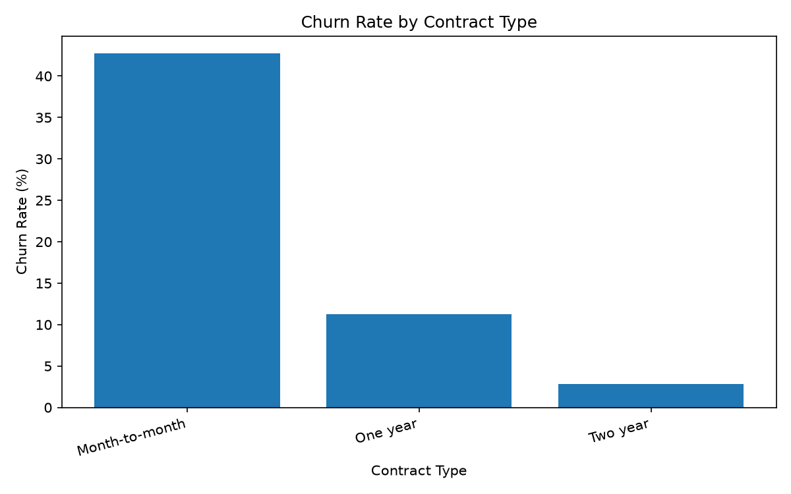
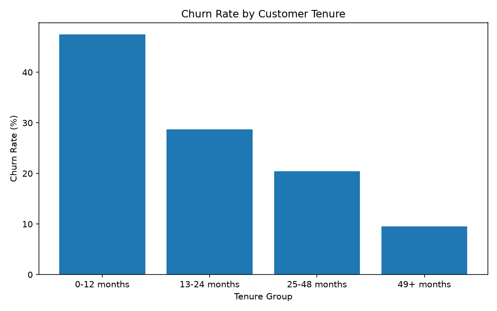
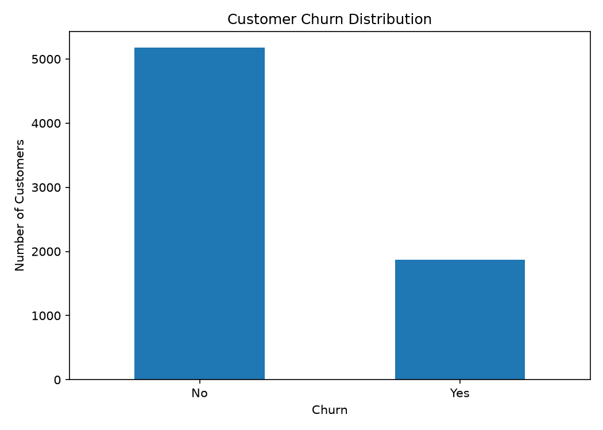

# 📊 Customer Churn Analysis | PostgreSQL & Python

## 📌 Project Overview

This project analyzes telecom customer data to identify churn patterns, understand customer retention, and discover factors associated with customer attrition. PostgreSQL is used for SQL-based analysis, while Python, Pandas, and Matplotlib are used for data cleaning, KPI calculation, and visualization.

## 🎯 Business Objectives

* Calculate the overall customer churn rate.
* Compare churn across contract types.
* Analyze churn patterns by customer tenure.
* Examine payment methods and monthly charges.
* Provide data-driven insights to support customer retention.

## 🛠️ Tech Stack

* **SQL:** PostgreSQL
* **Programming:** Python
* **Libraries:** Pandas, Matplotlib
* **Tools:** Visual Studio Code, GitHub

## 📂 Dataset

* **Records:** 7,043 customers
* **Features:** 21 columns
* **Target:** `Churn` (Yes/No)

## 📈 Key Performance Indicators

| KPI                | Result |
| ------------------ | -----: |
| Total Customers    |  7,043 |
| Churned Customers  |  1,869 |
| Retained Customers |  5,174 |
| Overall Churn Rate | 26.54% |

## 🔍 Key Findings

* **Overall churn:** 26.54% of customers in the dataset have churned.
* **Month-to-month contracts:** Churn rate is 42.71%.
* **One-year contracts:** Churn rate is 11.27%.
* **Two-year contracts:** Churn rate is 2.83%.

These findings show an association between contract type and customer churn. They do not, by themselves, establish causation.

## 📊 Visualizations

### Churn by Contract Type



### Churn by Customer Tenure



### Customer Churn Distribution



## 📁 Repository Structure

```text
Customer-Churn-Analysis/
├── SQL/
│   └── churn_analysis.sql
├── Customer-Churn.csv
├── customer_churn_analysis.py
├── churn_analysis.sql
├── churn_by_contract.png
├── churn_by_tenure.png
├── churn_distribution.png
├── requirements.txt
└── README.md
```

## ⚙️ How to Run

### 1. Clone the repository

```bash
git clone https://github.com/piyushparatwar33/Customer-Churn-Analysis.git
cd Customer-Churn-Analysis
```

### 2. Install dependencies

```bash
python -m pip install -r requirements.txt
```

### 3. Run the Python analysis

```bash
python customer_churn_analysis.py
```

The analysis generates cleaned data, summary CSV files, and visualizations in the `Python/outputs/` folder when run from the original project structure. If you place the Python script in the repository root, adjust its paths accordingly.

### 4. Run SQL analysis

Import the CSV into PostgreSQL as a table named `customer_churn`, then execute the queries in `SQL/churn_analysis.sql`.

## 💡 Business Recommendations

* Review the customer experience for month-to-month subscribers.
* Investigate early-tenure churn and onboarding issues.
* Evaluate retention offers using customer behavior and profitability data.
* Monitor churn rate regularly to assess retention initiatives.

## 👨‍💻 Author

**Piyush Paratwar**

GitHub: [piyushparatwar33](https://github.com/piyushparatwar33)
